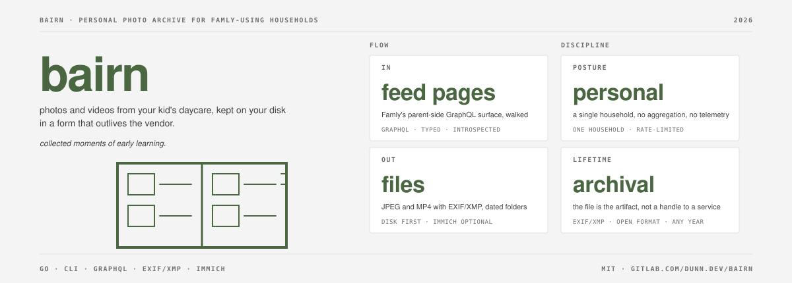
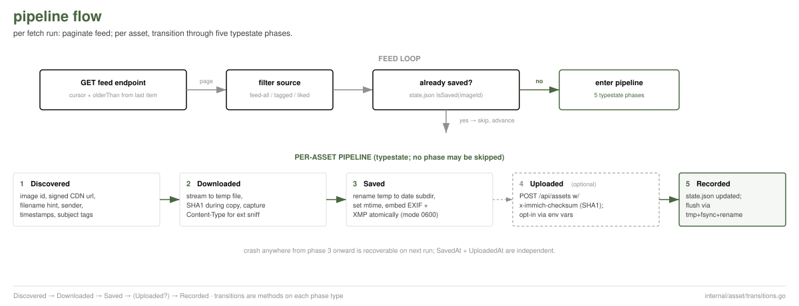

# bairn

[](LICENSE)

[](https://gitlab.com/dunn.dev/bairn/-/releases)


A personal archive tool for [Famly][famly]-using households. bairn
pulls your kid's photos and videos from Famly's nursery feed and
saves them to a directory on your own disk, with full metadata
(timestamps, post body, educator name, kid tags) embedded into each
file via [EXIF][exif] and [XMP][xmp]. Nothing about your child's
photo history depends on Famly continuing to exist as a company.

Bairn is an [archival][archival] tool, not a privacy gateway: every
piece of context the vendor exposes lands inside the file itself.
What happens to those files after you have them is your call.

[famly]: https://famly.co/
[exif]: https://en.wikipedia.org/wiki/Exif
[xmp]: https://en.wikipedia.org/wiki/Extensible_Metadata_Platform
[archival]: ./docs/decisions/0005-archival-posture.md

## Who this is for

You're a parent (or co-parent, grandparent, household admin) whose
kid's daycare or preschool uses Famly, and you:

- Want a [permanent local copy][permanent-local] of every photo and
  video the educators post, in date-organized folders that survive
  Famly outages, account closures, and corporate reshuffles.
- Want the metadata (post body, educator's name, the day the photo
  was taken) carried *inside* the file via standard EXIF/XMP, so any
  photo viewer or future archival workflow can read it.
- Are comfortable running a single Go binary from a terminal or
  cron, on a laptop or a small home server.

If your school doesn't use Famly, or if you're already happy with
how Famly's mobile app surfaces history, bairn is not for you.

[permanent-local]: https://en.wikipedia.org/wiki/3-2-1_backup_strategy

## What it does



bairn does five jobs:

1. **Authenticate.** You give bairn your Famly email and password
   once via `bairn login`; it exchanges them for a session token at
   the Famly GraphQL endpoint and verifies the token works for API
   calls. For unattended runs, set `FAMLY_EMAIL` and `FAMLY_PASSWORD`
   in your shell or cron environment so bairn re-authenticates when
   the session token rotates. A static `FAMLY_ACCESS_TOKEN` is also
   accepted for [MFA-protected accounts][mfa-fallback].

2. **Paginate the feed.** bairn walks Famly's
   `/api/feed/feed/feed` endpoint, page by page, stopping at
   `--max-pages` (default 3; `0` walks the whole feed, which a
   full-history backfill needs) or when Famly returns no more items.
   The default `--source=all` mode includes every image and video on
   each post; alternative `--source=tagged` and `--source=liked`
   filters are available for households whose schools tag photos per
   kid.

3. **Fetch the highest-resolution variant.** Famly's CDN serves
   sized variants under path segments like `/1024x768/`; bairn
   rewrites the segment to the image's reported original
   dimensions, so what lands on disk is the largest JPEG the server
   stored, not the medium thumbnail.

4. **Embed metadata in-file, then save atomically.** Each saved
   JPEG carries the post body, the post timestamp, the educator's
   name, and any per-image kid-tags as both [EXIF][exif] (legacy +
   ubiquitous) and [XMP][xmp] (modern, what Apple Photos and
   Lightroom prefer). Photos need no sidecar; everything travels with
   the image. Videos get a `<file>.xmp` beside them (description, date,
   tags), which Immich also receives as `sidecarData`. See [ADR 0005][adr-0005] for the archival contract.

5. **Track progress in a JSON state file.** A single
   `state.json` records what's been downloaded, saved, and
   (optionally) uploaded. Reruns skip work already done, and upload
   any saved asset Immich has not confirmed (uploaded or duplicate)
   from the disk sink, including its video `.xmp` sidecar, so a failed
   or skipped upload is fixed by rerunning `bairn fetch`. The run
   summary counts `saved`, `uploaded`, `uploadDuplicates` and
   `uploadFailed`. A 401 or 403 from
   Immich, or five failed uploads in a row, stops uploads for the rest
   of the run: the remaining assets are still saved to disk and counted
   in `uploadFailed`, and a rerun uploads them. State
   is flushed every 50 changes and on exit, so a hard kill redoes at
   most that many (disk and Immich checksum dedupe absorb the repeat).
   The state file lives under [`$XDG_STATE_HOME`][xdg] by default and is held
   under an OS file lock so concurrent runs fail fast rather than
   corrupt state.

[mfa-fallback]: ./docs/decisions/0003-auth-token-and-refresh.md
[adr-0005]: ./docs/decisions/0005-archival-posture.md
[xdg]: https://specifications.freedesktop.org/basedir-spec/basedir-spec-latest.html

## End-to-end setup

What you'll need:

- A [Famly][famly] account (your normal parent login).
- A laptop or small server that can run a Go 1.26+ binary.
- Under ten minutes for first-time setup. Subsequent runs are
  `bairn fetch`.

```
# 1. Build the binary.
git clone https://gitlab.com/dunn.dev/bairn.git
cd bairn
make build                                     # produces bin/bairn
sudo install bin/bairn /usr/local/bin/         # optional

# 2. Verify your Famly credentials work.
bairn login                                    # interactive, no-echo
# login: ok (logged in as you@example.com, N children visible)

# 3. Make those credentials available to fetch runs.
export FAMLY_EMAIL=you@example.com
export FAMLY_PASSWORD=<your-password>

# 4. Pull a small first batch.
bairn fetch --max-pages 1
bairn status
ls $XDG_DATA_HOME/bairn/assets/                # date subfolder; full-res JPEGs
bairn --version                                # also: bairn version
```

For unattended runs, put the env vars in a file (mode 0600) and
source it from your crontab or systemd unit.

### Or run the container

Each tagged release ships a minimal runtime OCI image (amd64; arm64 hosts use the signed
binary) at
`registry.gitlab.com/dunn.dev/bairn/cli` (`:latest` and `:vX.Y.Z`):

```
docker pull registry.gitlab.com/dunn.dev/bairn/cli:latest

docker run --rm \
  -e FAMLY_EMAIL -e FAMLY_PASSWORD \
  -v ~/Pictures/bairn:/data \
  registry.gitlab.com/dunn.dev/bairn/cli:latest \
  fetch --max-pages 1
```

The image's working directory is `/data`; saved photos and the JSON
state file land there. Mount a host directory so the archive
persists between runs. Optional Immich vars (`IMMICH_BASE_URL`,
`IMMICH_API_KEY`) wire the secondary sink as in the binary case.

## Configuration

Auth (one of these is required):

| Var | Purpose |
|---|---|
| `FAMLY_EMAIL` + `FAMLY_PASSWORD` | **Recommended.** bairn re-authenticates on token expiry. |
| `FAMLY_ACCESS_TOKEN` | Advanced; use when MFA is enabled on the account. |
| `FAMLY_DEVICE_ID` | Optional UUID pinning the device id sent to Famly. Default: the id stored in the session file, generated once at random. Set it in CI (see below). |

**Session file.** bairn keeps `session.json` next to the state file
(`$XDG_STATE_HOME/bairn/` by default, or the directory of
`BAIRN_STATE_PATH`). It holds two values: the device id Famly knows
this install by, and the last access token. The file is mode `0600`,
written atomically, and the token is never logged. A run starts from
the stored token and logs in with your password only when Famly
rejects it, so Famly's "new log-in activity" e-mail is not sent every
run. A token pasted in `FAMLY_ACCESS_TOKEN` wins over the stored one
for `fetch`, even when credentials are also set; if Famly rejects it,
bairn logs in with the credentials for that run only and writes no
token to the file while the variable is set. `bairn drift` with credentials
always logs in fresh and ignores both. `--dry-run` and `bairn drift`
never write the file. Delete the file to force a fresh login;
back it up like a credential, not like the archive.

**CI and containers.** A throwaway container has no session file, so
each run would generate a new device id and Famly would report a new
device. Set a fixed `FAMLY_DEVICE_ID` (any UUID you generate once, for
example with `uuidgen`) as a masked CI variable; the drift-gate job,
which runs on tags and weekly schedules, then always presents the same
device and the notices stop. Do the same for a container whose state
directory is not a persistent volume.

Save and state:

| Var | Purpose | Default |
|---|---|---|
| `BAIRN_SAVE_DIR` | Root for saved photos and videos | `$XDG_DATA_HOME/bairn/assets` |
| `BAIRN_STATE_PATH` | JSON state file | `$XDG_STATE_HOME/bairn/state.json` |
| `BAIRN_TZ` | IANA zone (`America/Detroit`) for the date of videos in posts with no zoned image; same as `--tz` | machine's local zone |
| `BAIRN_LOG_FORMAT` | `json` (cron) or `text` (interactive) | `json` |

Optional Immich sink (uploads alongside disk save):

| Var | Purpose | Default |
|---|---|---|
| `IMMICH_BASE_URL` | Immich API URL, ending in `/api`, e.g. `https://photos.example.com/api` | unset |
| `IMMICH_API_KEY` | Immich API key (User Settings → API Keys) | unset |
| `BAIRN_ALBUMS` | `1` files uploads into month and year albums with the default patterns | off |
| `BAIRN_ALBUM_MONTH` | Month album name pattern (`%Y %m %B %b`); setting it enables that album | unset (`EDC %B %Y` with `BAIRN_ALBUMS`) |
| `BAIRN_ALBUM_YEAR` | Year album name pattern; setting it enables that album | unset (`EDC %Y` with `BAIRN_ALBUMS`) |
| `BAIRN_ALBUM_SHARE` | Comma-separated Immich user UUIDs a new album is shared with as editors | unset |

**Immich version: v3.0.2 or later.** bairn targets the Immich 3.x
`/assets` upload contract, which no longer takes `deviceId` /
`deviceAssetId`; bairn does not send them, and 2.x servers that still
require them are not supported. It is verified against the
`IMMICH_VERSION` pin in the Makefile (albums and key permissions
included) through `make pre-tag-check`.

Exit codes for `bairn fetch`: 0 means the run finished with nothing
left over. 1 means the run ended but something failed (an item that
could not be downloaded or saved, an upload that failed, an album
operation that failed, or a write to the state file that failed), or a
runtime error stopped it; rerun to retry. An EXIF reinjection failure
is only a warning (the item is saved and uploaded) and still exits 0.
2 means a usage or configuration error. A scheduler's last-success
marker should advance only on 0.

CLI flag overrides for `bairn fetch`:

```
--max-pages N            stop after N feed pages (default 3, 0 = unlimited)
--tz ZONE                zone for videos in posts with no zoned image
                         (default: the machine's local zone)
--dry-run                enumerate without fetching or saving
--no-immich              save to disk only; skip Immich even when configured
--source MODE            feed filter: all (default; every image and video),
                         tagged (only images tagged with one of your children),
                         or liked (only images liked by a household login)
--save-dir DIR           override BAIRN_SAVE_DIR
--filename-pattern PAT   override the default filename template
--dir-pattern PAT        override the default directory template
--include-system-posts   include automated check-in/sign-out posts
                         (off by default; their templated text isn't great
                         photo caption material)
--albums                 file Immich uploads into month and year albums,
                         using the default patterns below (BAIRN_ALBUMS=1)
--album-month PAT        month album name; setting it enables that album
                         (BAIRN_ALBUM_MONTH; with --albums: "EDC %B %Y",
                         e.g. "EDC November 2026")
--album-year PAT         year album name (BAIRN_ALBUM_YEAR; with --albums:
                         "EDC %Y")
--album-share IDS        comma-separated Immich user IDs (UUIDs) a newly
                         created album is shared with as editors
                         (BAIRN_ALBUM_SHARE)
--allow-missing-state    upload even though the state file is missing and the
                         save dir already holds media (refused by default)
```

Albums are off unless `--albums` or a pattern is set. Patterns take
`%Y %m %B %b`, read in the run's zone at the post date. An album is
found by exact name among the albums the API key's owner owns and is
created only if absent, so reruns add to the same album. bairn only
adds assets to albums; it never removes an asset, deletes an album or
trashes anything. The Immich API key needs exactly these permissions
and no more: `asset.upload`, and for albums `album.read`,
`album.create` and `albumAsset.create` (checked against Immich
v3.4.2). Share with user IDs rather than emails so the key needs no
`user.read`.

The state file is the tombstone. An asset it records as uploaded is
never uploaded again, even if you later delete it in Immich, so back
the state file up with the archive. An asset Immich refuses for an
album (for example one deleted since upload) is recorded as refused
and skipped from then on. Uploads from before 0.6.0, which carry no
post date, are filed once from the creation time already in the
state file. `bairn status` shows `albumsFiled`, `albumsUnfiled` and
`albumsRefused`. `bairn smoke immich` deletes only its own test
asset, albums and key, through a login session on the smoke account.

## Filename layout

Default: `{{.Source}}-%Y-%m-%d_%H-%M-%S-{{.ID}}.{{.Ext}}` under
`%Y-%m-%d/`. So a real saved file looks like
`2026-05-06/feed-image-2026-05-06_18-33-21-<uuid>.jpg`. Tokens:

- Strftime: `%Y %m %d %H %M %S %j` (UTC, from the asset's vendor-side
  timestamp).
- Go template: `{{.Source}} {{.ID}} {{.FeedItemID}} {{.Ext}}`.

Override `--filename-pattern` and `--dir-pattern` to match your own
layout convention.

## Embedded metadata, per file

bairn writes both EXIF and XMP, on the principle that some readers
prefer one and some prefer the other (see [ADR 0005][adr-0005]).
Concretely:

| Tag | Source | Notes |
|---|---|---|
| EXIF `DateTimeOriginal` | `image.createdAt.date` | Famly's timestamp for the image. |
| EXIF `OffsetTimeOriginal` | `image.createdAt.timezone` | Read from Famly; commonly UTC. |
| EXIF `ImageDescription` | post body, sanitized | Newlines collapsed; truncated at word boundary. |
| EXIF `Artist` / XMP `dc:creator` | educator name | Whoever posted. |
| EXIF `Software` | bairn version | Self-attribution. |
| EXIF `UserComment` | full body + sender | Unicode-safe; some viewers warn on dsoprea's "Unicode" prefix. |
| XMP `dc:description` | full body | Newlines preserved; XMP can carry them safely. |
| XMP `dc:subject`, `digiKam:TagsList` | per-image kid tag names (flat; Immich reads TagsList) | When Famly tags the photo per child. |
| XMP `photoshop:DateCreated` | image timestamp | ISO 8601 with offset. |

A video carries no zone, so its sidecar date borrows the zone of a
zoned image in the same post. A post with no zoned image uses `--tz` /
`BAIRN_TZ`, else the zone of the machine running bairn, with the
offset computed at the post's date (daylight saving included). Run
the backfill on a machine whose clock is in the family's zone, or set
`--tz`. The zone in use is logged at the start of every fetch.

GPS coordinates are off by default. They embed only when the
operator supplies coordinates explicitly.

## Local dev and smoke testing

```
make gen           regenerate api/famly/gen.go
make test          go test -race ./...
make smoke-immich  live round-trip against the operator's Immich
make pre-tag-check lint + test + smoke-immich (run before git tag)
make lint          golangci-lint run
make build         bin/bairn for the host
make build-linux   bin/bairn-linux-amd64 (headless server deploy)
make build-darwin  bin/bairn-darwin-arm64 (Apple Silicon laptop)
make build-all     both of the above
```

### Pre-tag gate

Before cutting a release tag, run:

```
make pre-tag-check
```

That runs golangci-lint, the unit suite, **and** a real-server
round-trip against your Immich: login, mint an ephemeral API key,
upload a tiny JPEG via the production sink, assert created, delete
the asset, delete the API key. The round-trip catches controller-
layer wire-contract enforcement that no static spec models. v0.4.3
shipped without this gate and broke uploads against Immich v2.7.5;
v0.4.6 added the smoke and v0.5.0 folded lint into the same gate.

`make smoke-immich` reads `IMMICH_BAIRN_HOST` /
`IMMICH_BAIRN_USER` / `IMMICH_BAIRN_PASSWORD` (recommended: a
quota-limited test user separate from your archive account), or
falls back to `IMMICH_BASE_URL` / `IMMICH_API_KEY` for ad-hoc
runs. It is a local gate only: CI runners cannot reach a LAN Immich.

On the login path the smoke also runs the album leg: it mints a key
with only `asset.upload`, `album.read`, `album.create` and
`albumAsset.create`, uploads a tiny asset and files it into uniquely
named `bairn-smoke-*` month and year albums twice through the same
filer fetch uses, asserts one album per name, the asset in each and
(with `SMOKE_SHARE_USER_EMAIL` set) that user as editor, then deletes
the albums, asset and key with the login session, even on failure.

`IMMICH_VERSION` in the Makefile is the Immich release bairn is
verified against via `make pre-tag-check`. Renovate proposes bumps
(automerge off); a bump MR means: upgrade the home Immich, then run
`make pre-tag-check`.

`make gen` reads `api/famly/schema.graphql`, the hand-curated SDL
bairn validates operations against. Introspection
(`discovery/probe/introspect.py`) is an optional discovery aid.

`make test` includes a metadata round-trip test that uses
`exiftool -j` to read back what bairn wrote and assert it matches
intent. The test is skipped automatically when `exiftool` isn't on
PATH, so a bare CI without it stays green; `make pre-tag-check` is
the only place that round trip and the live Immich contract run, so
it fails when `exiftool` is missing. Install with
`brew install exiftool` (mac) or
`apt install libimage-exiftool-perl` (debian).

## Discovery and drift

bairn talks to a vendor surface we don't control. The
[discovery toolkit](./discovery/PROTOCOL.md) is bairn's
methodology for noticing when Famly's response shapes change. Three
modes:

- **Shape probe** (`bairn drift`): hit a known endpoint list, record
  JSON-key signatures, diff against committed baselines; see
  [`discovery/baselines/main/README.md`](./discovery/baselines/main/README.md).
- **Traffic capture**: drive Famly's web app via Playwright,
  capture HARs, find endpoints we don't yet know about.
- **Schema introspection**: when a vendor exposes GraphQL with
  introspection enabled, dump the schema for typed code gen.

Captures, HARs, schema dumps and local manifests stay untracked on
purpose. The canonical `discovery/probe/manifest.toml` and the
anonymized `discovery/baselines/main/` shapes are the exception: they
are committed because the CI drift gate reads them.

## Privacy posture

Discovery captures, HAR files, schema dumps, local manifests and the
generated state file are gitignored. The committed source tree
carries the methodology, plus the canonical endpoint manifest and
the anonymized `main` baseline, which the CI drift gate needs.

The [discovery toolkit](./discovery/) is generic. Operators provide
their own manifest (copy from `discovery/probe/manifest.example.toml`
to the ignored `discovery/probe/manifest.local.toml`) and run probes against their own
credentials.

Files saved by bairn default to mode `0600` because the photos and
their embedded metadata describe minors. The operator can loosen
explicitly. Bairn embeds every piece of context Famly exposes into
the file's metadata; what travels with the file when the operator
moves it is the operator's call.

## Status

The disk-first save path is validated against the maintainer's Famly
account, with full EXIF and XMP embedded and reruns idempotent; other
accounts are not yet covered. The Immich path is live-tested against
the `IMMICH_VERSION` pin through `make pre-tag-check` before each
tag. A weekly drift check compares Famly's response shapes against
committed baselines. GitHub releases on the mirror carry notes only;
signed binaries, SBOMs and provenance live on the GitLab release.

## Architecture

The non-obvious design decisions are written up under
[`docs/decisions/`](./docs/decisions/). If you read one
supplementary file beyond this README, make it
[ARCHITECTURE.md](./ARCHITECTURE.md).

The seven ADRs:

- [0001](./docs/decisions/0001-spec-first-clients.md) spec-first typed clients via codegen
- [0002](./docs/decisions/0002-typestate-asset-lifecycle.md) typestate for the asset lifecycle
- [0003](./docs/decisions/0003-auth-token-and-refresh.md) Famly auth: token-first with optional refresh
- [0004](./docs/decisions/0004-state-as-json-file.md) state as a JSON file with file lock
- [0005](./docs/decisions/0005-archival-posture.md) archival posture, in-file metadata (video XMP sidecar only)
- [0006](./docs/decisions/0006-sink-abstraction.md) sink abstraction (disk + Immich + future)
- [0007](./docs/decisions/0007-llm-augmented-ci.md) drift gate in CI (LLM triage removed)

## Prior art

- [`jacobbunk/famly-fetch`][jacobbunk] (Python). Built an integration
  against Famly's API first; bairn's REST surface follows that map.
  Different design (streamed downloads, JSON state, optional Immich
  layer, in-file photo metadata, XMP sidecar for video only) and different language
  but same conceptual lineage. Established prior art; see
  [`NOTICE.md`](./NOTICE.md) for context.

[jacobbunk]: https://github.com/jacobbunk/famly-fetch

## On the integration path

bairn implements Famly's parent-side API surface using the operator's
own credentials, against the same endpoints the official mobile and
web apps use. It is the single-household, personal-archive expression
of that path: one operator, one account, one host, human-rate access
(requests paced at the rate a single human user would naturally
generate; see condition 4 in `NOTICE.md`). See [`NOTICE.md`](./NOTICE.md)
for the integration-path detail and the full conditions under which
using bairn is reasonable.

A parent-side data-export feature has been on Famly's product
backlog since 2024 without delivery. Until that feature ships,
bairn provides a local archive so that a kid's photo history isn't
indefinitely contingent on Famly continuing to host it.

If your organization needs richer integration than bairn (multi-
account, push notifications, write access, write-back to Famly),
the official API access add-on is the right answer. bairn is
explicitly *not* that.

## License

[MIT](./LICENSE).

bairn is not affiliated with Famly. Use only with credentials for an
account you own. Respect rate limits like a single human user would.
This is a personal-archive tool: single household, single account,
single host. See [`NOTICE.md`](./NOTICE.md) for full context.
